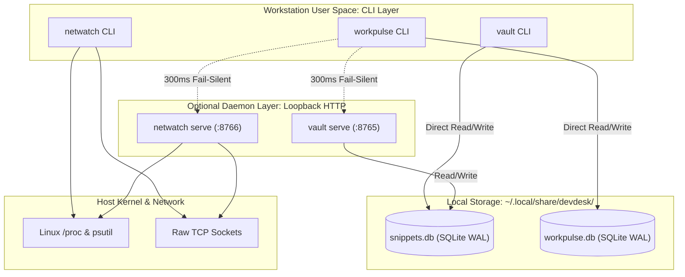

# DevDesk Local Ecosystem

[](https://github.com/Dinu-Sreekumar/devdesk-ecosystem)
[](LICENSE)
[](https://github.com/Dinu-Sreekumar/devdesk-ecosystem/releases)
[](docs/cli-reference.md)
[](https://github.com/Dinu-Sreekumar/devdesk-ecosystem)

> **DevDesk Local Ecosystem** is a decoupled, developer-first productivity and network diagnostic suite for Linux workstations. Built from the ground up for extreme speed (<5ms local CLI execution), zero cloud dependencies, and resilient POSIX compliance.

The suite consists of three specialized utilities that operate independently as standalone command-line tools or collaboratively via non-blocking localhost HTTP contracts:
* **`vault`** — Stash, tag, syntax-highlight, and pipe terminal code snippets into local SQLite.
* **`netwatch`** — Deterministic port scanner, process attribution inspector, and WAN health probe.
* **`workpulse`** — Pomodoro deep-work focus tracker with rich terminal countdown and peer awareness.

---

## 1. System Architecture

The DevDesk ecosystem adheres to **Decoupled Autonomy**: each tool has zero runtime dependency on the others. Direct CLI execution touches disk directly for maximum performance. Optional daemon modes (`vault serve` and `netwatch serve`) expose lightweight FastAPI interfaces on loopback, enabling WorkPulse to provide ambient system awareness without blocking.



### Architectural Guarantees:
* **Direct-to-Disk CLI:** Standard commands never make network round-trips. They query SQLite directly with Write-Ahead Logging (`WAL`), guaranteeing immediate terminal responsiveness.
* **Fail-Silent Peer Client:** WorkPulse queries peer daemons with an aggressive 300ms timeout. If a daemon is offline or stopped, WorkPulse continues without lag or crashes.
* **Root-Safe Process Inspection:** NetWatch catches Linux permission boundaries (`psutil.AccessDenied`) gracefully, allowing unprivileged developers to scan ports without requiring `sudo`.

---

## 2. Compatibility & Pre-Flight Verification

DevDesk pre-compiled binaries are statically packed for modern Linux environments running on `x86_64` (glibc 2.31+).

### Compatibility Matrix

| Operating System | Architecture | Supported | Method |
|:---|:---|:---:|:---|
| **Linux (Fedora, Ubuntu, Debian, Arch, RHEL)** | `x86_64` / `amd64` |  Yes | Pre-compiled Binary or Source |
| **Linux (Raspberry Pi, AWS Graviton)** | `aarch64` / `arm64` |  Yes | Build from Source (`make build`) |
| **macOS (Darwin)** | `x86_64` / `arm64` |  Source | Build from Source with Python 3.10+ |
| **Windows (WSL2)** | `x86_64` |  Yes | Pre-compiled Binary inside WSL2 |

### 1-Line Pre-Flight Compatibility Check
Run this in your terminal before installing to confirm your system meets pre-compiled binary requirements:

```bash
uname -sm && (command -v ldd >/dev/null 2>&1 && ldd --version | head -n1 || echo "glibc standard")
```
* **Expected Output:**
  ```text
  Linux x86_64
  ldd (GNU libc) 2.34 (or newer)
  ```

---

## 3. 1-Line Installation

DevDesk provides automated installer scripts that verify system compatibility, configure permissions, and place executables in `~/.local/bin/`.

### Install Complete Suite (All 3 Tools)
```bash
curl -fsSL https://raw.githubusercontent.com/Dinu-Sreekumar/devdesk-ecosystem/main/scripts/install.sh | bash
```

### Install Individual Utilities
Need only one specific tool? Install standalone binaries independently:

* **SnippetVault Only (`vault`):**
  ```bash
  curl -fsSL https://raw.githubusercontent.com/Dinu-Sreekumar/devdesk-ecosystem/main/scripts/install-vault.sh | bash
  ```

* **NetWatch Only (`netwatch`):**
  ```bash
  curl -fsSL https://raw.githubusercontent.com/Dinu-Sreekumar/devdesk-ecosystem/main/scripts/install-netwatch.sh | bash
  ```

* **WorkPulse Only (`workpulse`):**
  ```bash
  curl -fsSL https://raw.githubusercontent.com/Dinu-Sreekumar/devdesk-ecosystem/main/scripts/install-workpulse.sh | bash
  ```

> [!TIP]
> Ensure `~/.local/bin` is in your shell `PATH`. If commands are not found immediately, add this line to your `~/.bashrc` or `~/.zshrc`:
> ```bash
> export PATH="$HOME/.local/bin:$PATH"
> ```

---

## 4. Ecosystem Components

### SnippetVault (`vault`)
**SnippetVault** is a local-first knowledge stash and background REST daemon designed to capture terminal one-liners, SQL migrations, API payloads, and error logs without context switching. Supporting direct Unix stdin piping (`cat script.py | vault save ...`), full-text search, and Monokai syntax-highlighted terminal rendering, it ensures sensitive developer snippets remain private and fully offline within an XDG-compliant SQLite database. When running in daemon mode (`vault serve` on port `8765`), external tools can query and associate snippets with active work sprints.
* **[Read Full SnippetVault Documentation](docs/snippetvault.md)**

---

### NetWatch (`netwatch`)
**NetWatch** is a high-speed network diagnostics utility and REST service engineered to eliminate developer friction around conflicting ports and silent connection drops. It combines non-blocking raw TCP socket handshakes with Linux procfs process attribution to pinpoint the exact PID, executable name, and owner holding a port (such as Docker, Node.js, or PostgreSQL) without requiring root permissions. Featuring deterministic Unix exit codes (`0` for free/available, `1` for in-use/occupied) and a non-privileged WAN latency ping mechanism, NetWatch serves as an indispensable tool for terminal debugging and automated CI/CD readiness checks.
* **[Read Full NetWatch Documentation](docs/netwatch.md)**

---

### WorkPulse (`workpulse`)
**WorkPulse** is a terminal productivity engine and local peer orchestrator that structures deep-work blocks through real-time, non-flickering Pomodoro timers. Operating against an isolated SQLite session database, WorkPulse tracks focus analytics, sprint durations, completion rates, and custom category tags while providing graceful interrupt handling (`Ctrl+C`). It features a fail-silent 300ms peer client that transparently queries local SnippetVault and NetWatch daemons, allowing developers to correlate focus sprints with code captured and listening services in a unified terminal view.
* **[Read Full WorkPulse Documentation](docs/workpulse.md)**

---

## 5. Master CLI Reference

For complete command-line documentation, options, arguments, exit codes, and shell pipeline recipes across all utilities, consult the unified guide:

* **[Master CLI Reference & Recipes](docs/cli-reference.md)**

### Quick Command Cheat Sheet:
```bash
# SnippetVault
vault save "Docker build sequence" --lang bash --tag docker
vault list --tag docker
vault get 1

# NetWatch
netwatch check 8080
netwatch scan
netwatch ping

# WorkPulse
workpulse start "Backend Refactor" --duration 25 --tag refactor
workpulse peers
workpulse stats
workpulse log
```

---

## 6. Building from Source

If the pre-compiled `x86_64` binaries are incompatible with your system (e.g. ARM/aarch64, older glibc, macOS, or WSL1), you can build DevDesk natively from source on any platform with Python 3.10+.

### Prerequisites
* **Python 3.10+** with `pip` and `venv`
* **`make`** (GNU Make)
* **Linux/macOS/WSL2** (Windows native is not supported)

### Build Sequence
```bash
# 1. Clone the repository
git clone https://github.com/Dinu-Sreekumar/devdesk-ecosystem.git
cd devdesk-ecosystem

# 2. Create virtual environment and install all dependencies
make setup

# 3. Activate the virtual environment
source .venv/bin/activate

# 4. Compile standalone single-file binaries via PyInstaller
make build

# 5. Verify the compiled executables
./dist/vault --help
./dist/netwatch --help
./dist/workpulse --help

# 6. Install compiled binaries to ~/.local/bin/
make install
```

> [!TIP]
> If you only want to **run without compiling** (no PyInstaller), you can execute the tools directly from source after `make setup`:
> ```bash
> source .venv/bin/activate
> python3 -m snippetvault.src.main --help
> python3 -m netwatch.src.main --help
> python3 -m workpulse.src.main --help
> ```

### Troubleshooting Build Issues

| Problem | Cause | Fix |
|:---|:---|:---|
| `ModuleNotFoundError` during build | Missing dependencies | Run `make setup` or `pip install -r requirements.txt` |
| `EADDRINUSE` on `vault serve` / `netwatch serve` | Port already in use | Check with `netwatch check 8765` and stop the conflicting process |
| `glibc` version mismatch on compiled binary | Binary compiled on a newer glibc | Rebuild from source on your machine with `make clean && make build` |
| PyInstaller `--onefile` fails on macOS | Code signing or permissions | Run with `--windowed` disabled; see [PyInstaller macOS docs](https://pyinstaller.org/en/stable/usage.html) |

---

## 7. License & Credits

The DevDesk Local Ecosystem is licensed under the **[MIT License](LICENSE)**. Created and maintained by [Dinu Sreekumar](https://github.com/Dinu-Sreekumar).
